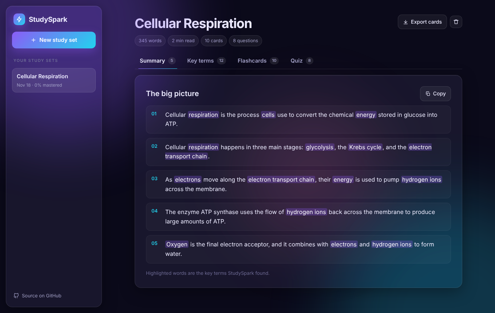
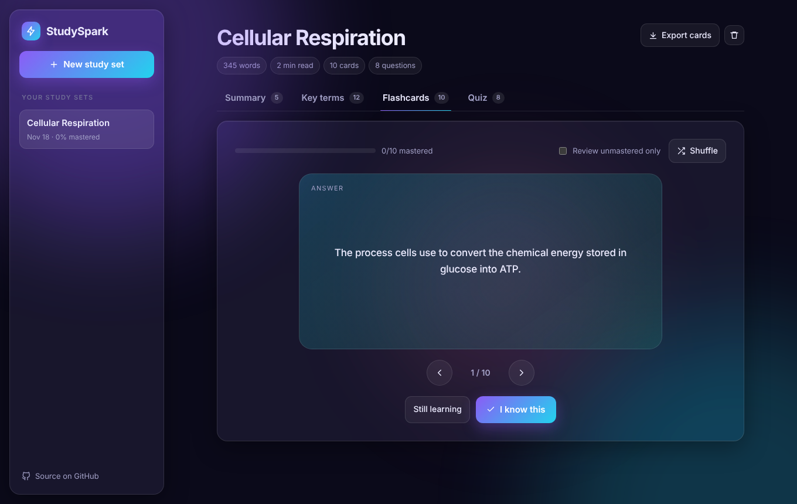
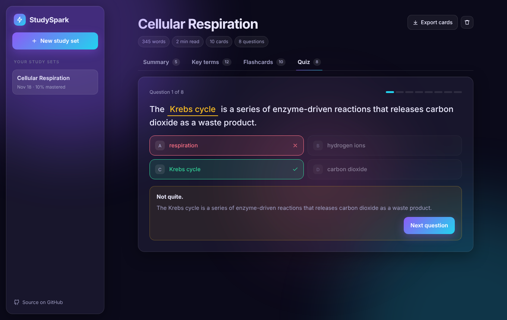

# ⚡ StudySpark

**Turn your notes into summaries, flashcards and quizzes in seconds.** Paste lecture notes or upload a PDF, DOCX or text file, and StudySpark finds the key ideas, builds flip cards from the definitions it detects, and quizzes you with fill-in-the-blank questions.

It runs on **classic NLP that I implemented myself** (TextRank, TF-IDF and pattern mining), so it's free to run, fast, and needs **no paid AI API key**.

🔗 **Live demo:** https://studyspark-pnnb.onrender.com/ (free tier, so the first load may take ~30s to wake up)




| Flashcards | Quiz |
|---|---|
|  |  |

---

## ✨ Features

- **📄 Any notes:** paste text, or upload **PDF, DOCX, TXT or Markdown** (up to 10 MB)
- **🧠 Extractive summaries:** short, medium or long, with key terms highlighted
- **🏷️ Key terms:** ranked 1–3 word concepts, each with the sentence that best explains it
- **🃏 Flashcards:** 3D flip cards, mastery tracking, "review unmastered only" mode, shuffle and keyboard shortcuts (Space to flip, ← → to move, K to mark known)
- **✅ Quizzes:** fill-in-the-blank multiple choice with instant feedback, explanations and a best-score record
- **💾 Saved sets:** stored in your browser (`localStorage`), so there's no account and your notes never sit on a server
- **📤 Export:** flashcards download as CSV, ready to import into **Anki** or **Quizlet**
- **📱 Responsive:** dark glassmorphism UI that works on phones too

## 🔬 How the NLP works

All of it lives in [`studyspark/nlp.py`](studyspark/nlp.py).

| Step | Technique |
|---|---|
| **Cleaning** | Repairs words hyphenated across PDF line breaks, re-joins wrapped lines, detects headings and strips Markdown |
| **Sentence splitting** | Regex splitter that handles abbreviations (*Dr.*, *e.g.*), initials and decimals |
| **Summary** | **TextRank**: sentences become TF-IDF vectors, a cosine-similarity graph is built, and **PageRank** (NetworkX) scores each sentence. The top ones are returned in reading order |
| **Key terms** | TF-IDF over 1–3-grams with sublinear TF, a boost for multi-word phrases, a minimum document frequency for phrases, and removal of overlapping terms |
| **Flashcards** | Finds definition patterns (*"X is / refers to / is defined as Y"*), filters out pronoun subjects, and falls back to concept cards built from key terms |
| **Quiz** | Blanks a key term in its best context sentence. Distractors are other key terms of the same length, so the wrong answers look plausible |

## 🏗️ Architecture

```
frontend/ (React 19 + TypeScript, bundled with esbuild)
   │  fetch /api/analyze  (JSON text  or  multipart file upload)
   ▼
studyspark/app.py (Flask)
   ├─ extract.py    PDF (pypdf) · DOCX (python-docx) · TXT/MD → text
   └─ nlp.py        clean → split → summarize / key_terms / flashcards / quiz
```

The backend is **stateless**. Study sets are saved client-side, which keeps the server simple and free-tier friendly.

## 🚀 Run locally

```bash
# backend
python -m venv .venv && source .venv/bin/activate   # Windows: .venv\Scripts\activate
pip install -r requirements-dev.txt
flask --app studyspark.app run                       # http://127.0.0.1:5000

# frontend (only needed if you change the UI; the built files in frontend/dist are committed)
cd frontend
npm install
npm run build      # or: npm run dev  (rebuilds on save)
```

## 🧪 Tests

```bash
pytest -q
```

The 22 tests cover text cleaning, sentence splitting, summary ordering and length, definition detection, quiz validity (four distinct options, and the answer filled back into the blank must reproduce the source sentence), deterministic seeding, PDF and DOCX extraction, bad-file handling, and every API success and error path. GitHub Actions runs them on every push, along with a frontend typecheck and build.

## ☁️ Deploy (free)

This repo includes a [`render.yaml`](render.yaml) blueprint:

1. Sign in to [render.com](https://render.com) with GitHub
2. **New → Blueprint** and pick this repo
3. Click **Apply**. Render installs the requirements and starts Gunicorn

## 📡 API

`POST /api/analyze`

- JSON body: `{ "text": "...", "length": "short|medium|long", "title": "optional" }`
- or `multipart/form-data` with `file` and an optional `length`

It returns `title`, `stats`, `summary[]`, `key_terms[]`, `flashcards[]` and `quiz[]`. Errors come back as `{ "error": "message" }` with status 400, 413 or 422.

## 🗺️ Roadmap

- Optional LLM mode (bring your own API key) for open-ended questions
- Spaced-repetition scheduling (SM-2) for flashcards
- OCR for scanned PDFs

---

Built by **[Chirandan Raaman Murugan](https://github.com/chiru-6)**, MS CS @ Texas Tech University. MIT licensed.
